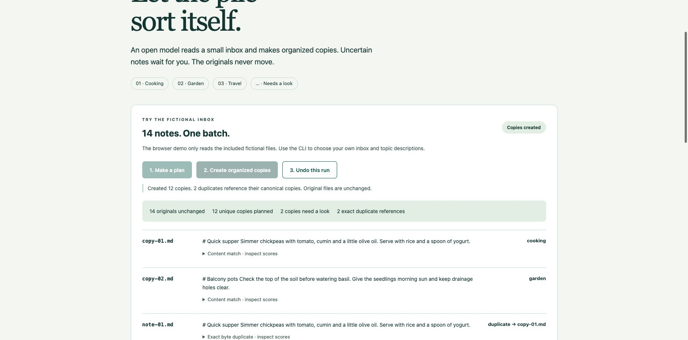

# Doze Sort

A local batch sorter for a small pile of English Markdown and text notes. An open-weight model compares file contents with topic descriptions, then a reviewed plan creates organized copies. Originals stay where they are. Exact byte duplicates reference a canonical copy; uncertain notes go to `_review`.



[35-second screen-state walkthrough](docs/demo.mp4): use **Download raw file** on GitHub. It is assembled from real screenshots, not a continuous recording. [Actual diagnostic output](docs/evaluation.json) includes the mixed-topic failure.

## Start the fictional demo

Python 3.12 was used. The browser demo only reads `examples/inbox` and writes under `.runtime/output` inside this repository. It cannot accept arbitrary file paths or uploads.

```sh
python3.12 -m venv .venv
.venv/bin/python -m pip install -r requirements.lock
.venv/bin/python server.py
```

Open http://127.0.0.1:8799. First startup downloads the pinned model from Hugging Face, requiring internet. The default cache is `~/.cache/doze-sort`; set `DOZE_SORT_CACHE` to use another directory. After the model is cached, restart offline:

```sh
HF_HUB_OFFLINE=1 TRANSFORMERS_OFFLINE=1 .venv/bin/python server.py
```

Choose **Make a plan**, inspect the filenames, excerpts and score details, then **Create organized copies**. **Undo this run** moves the active run directory to `.undone-<id>` inside the output directory. It retains all copies and the manifest. It deletes zero files. The browser state is in memory; restarting the server loses the visible session but not completed run folders. Use the CLI to inspect or undo those runs.

There are no remote fonts, scripts, analytics, paid APIs or background scans. The loopback server rejects other Host and Origin values. It logs no request bodies. A local app and model download still require storage and a capable laptop.

## Use the CLI with an inbox you choose

Run on your own small, stable inbox, with no other process changing the input or output while it operates. Copy-only operation reduces the cost of a wrong classification; this is not a backup system or an adversarial multi-user file service.

```sh
.venv/bin/python sorter.py plan /absolute/path/to/inbox /absolute/path/to/sorted --topics topics.json --save plan.json
```

The plan contains absolute local paths, original excerpts, hashes and proposed folders. Keep it private if the inbox is private. Review it before applying. A wrong suggestion can be changed to `_review` in the plan JSON, or adjust topic descriptions and create a fresh plan using another save filename. The browser demo does not include per-row editing.

```sh
.venv/bin/python sorter.py apply plan.json
.venv/bin/python sorter.py undo /absolute/path/to/sorted RUN_ID_FROM_PLAN
```

A plan is applied at most once. The same ID cannot be applied again, even after undo. Each new plan produces a separate snapshot; the tool does not synchronize or update previous runs. Before a copy, it checks all supported source filenames and SHA-256 hashes against the planned snapshot. Added or changed files require a fresh plan. Copies are staged before the completed run becomes active. A failed filesystem operation can leave a hidden `.stage-<id>` folder for manual inspection.

Undo verifies the manifest, copy hashes and unexpected files. If a copy has been edited or an extra file appeared, it stops and leaves the run in place. It never overwrites a recovery folder. These checks assume a stable filesystem, not a hostile writer racing file operations. Do not edit manifests or operate on the same folders concurrently.

## Inputs and model

Only visible, top-level `.md` and `.txt` UTF-8 files are processed. No recursion, PDF, images, symlinks, empty files or arbitrary binary content. Up to 200 top-level entries, 32 KiB per supported file. Descriptions and files exceeding the model's token limit are rejected without silently truncating them. Input and output folders cannot contain each other.

Topics are 2–12 user-defined lowercase IDs and English descriptions in `topics.json`. The included topics are cooking, gardening and travel. The examples are fictional original notes with deliberately vague filenames.

[all-MiniLM-L6-v2](https://huggingface.co/sentence-transformers/all-MiniLM-L6-v2), revision `1110a243fdf4706b3f48f1d95db1a4f5529b4d41`, Apache-2.0, runs through [Sentence Transformers](https://www.sbert.net/) on CPU. It embeds content and topic descriptions into normalized 384-dimensional vectors. Cosine similarity selects a topic only when the top score is at least 0.30 and the top-two gap is at least 0.06. Otherwise the copy goes to `_review`. These are uncalibrated heuristics, not probabilities. The model does not execute instructions found in a note or generate new file contents.

Deduplication uses identical SHA-256 bytes, not semantic similarity. A manifest records each duplicate's original name and canonical source. Originals are never removed. Spelling, formatting or newline differences make distinct files; similar notes are not merged.

## Recorded results and limits

```sh
.venv/bin/python -m unittest discover -s tests -v
.venv/bin/python evaluate.py
```

Seven behavior/integration tests passed, including byte preservation, exact duplicates, replay prevention, stale input, edited/extra output, path and symlink rejection, token rejection and recoverable undo. Actual cached inference ran with offline environment flags.

On 14 author-written fictional files, 13 outcomes matched the author's intended category, duplicate reference or review decision. Twelve unique copies were made: ten classified and two placed in `_review`; two exact duplicates referenced canonical copies. One mixed note mentioning baking, herb pots and a train was assigned cooking when the author intended review. The failure remains in `docs/evaluation.json`; the thresholds do not reliably detect every mixed-topic note.

The actual apply/recovery exercise left all 14 source files byte-identical, preserved the recovered run, and deleted no files. Warm planning median was 14.92 ms across five runs; first plan 25.40 ms; apply 1.87 ms. Model loading is excluded. This is a small diagnostic, not an independent benchmark. No human filing-time comparison, personal inbox trial or external user study was performed.

The browser flow completed plan, copy and undo, then showed recovery with zero deletions. At a 375px viewport, document width was also 375px with no horizontal overflow. Images in `docs/` are real browser states.

The payoff tested here is one batch action producing a categorized snapshot instead of opening and filing each note individually. Inspecting a bad plan, refining topic descriptions, storage for snapshots, and recovery management still require effort. The original pile is intentionally retained, so this organizes a working copy rather than clearing the source inbox.

Started October 20, 2026 for [Hacktoberfest Week 3: Slow and Steady](https://dev.to/challenges/hacktoberfest-week3-2026-10-19), inside the entry period. The sorter, transaction logic, example files and UI are new for this week. An existing personal Python environment and cached weights were reused. No employer or client files were accessed.

## License

MIT for the code and original examples, copyright 2026 Renchao Wu. Model weights retain Apache-2.0. Dependencies keep their respective licenses; see `requirements.lock`. Neither dependencies nor weights are vendored.
